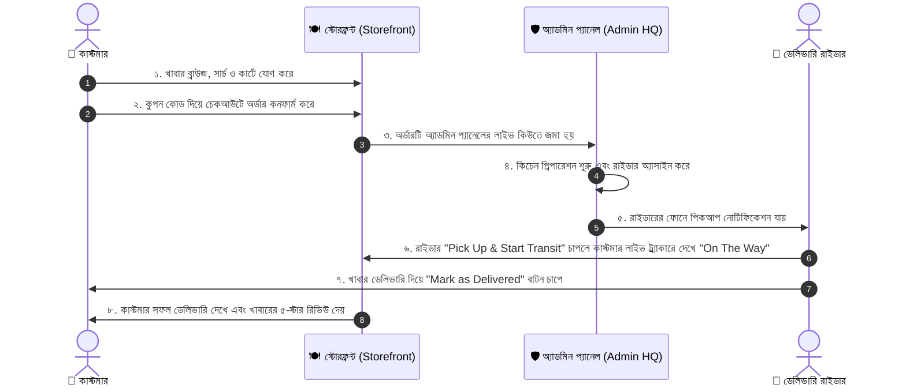

# 📖 Restaurant Order Management System — সম্পূর্ণ ইউজার ও টেকনিক্যাল গাইডলাইন

এই প্রজেক্টটি একটি ফুল-স্ট্যাক আধুনিক **রেস্তোরাঁ অর্ডার ম্যানেজমেন্ট সিস্টেম (Gourmet Royale)**। এখানে কাস্টমার, রেস্তোরাঁ অ্যাডমিন এবং ডেলিভারি রাইডার—এই তিনজনের জন্য আলাদা আলাদা ইন্টারফেস এবং রিয়েল-টাইম ওয়ার্কফ্লো তৈরি করা আছে।

---

## 🛠️ ১. কি কি টেকনোলজি ব্যবহার করা হয়েছে? (Technology Stack)

### **ফ্রন্টএন্ড (Frontend):**
* **HTML5**: আধুনিক সিম্যান্টিক লেআউট এবং এসইও-বান্ধব মার্কআপ।
* **ভ্যানিলা CSS3 (Vanilla CSS3)**: কোনো থার্ড-পার্টি ফ্রেমওয়ার্ক (যেমন Tailwind) ছাড়া সম্পূর্ণ কাস্টম লাক্সারি গোরমেট ডিজাইন সিস্টেম (Glassmorphism, Dark Warm Theme, Smooth Transitions, এবং Micro-animations)।
* **ভ্যানিলা JavaScript (ES6+)**: অ্যাসিঙ্ক্রোনাস `fetch` এপিআই দিয়ে পেজ রিলোড ছাড়াই ইনস্ট্যান্ট কার্ট, লাইভ সার্চ, ডাইনামিক ফিল্টারিং, চেকআউট এবং রিয়েল-টাইম ট্র্যাকিং কন্ট্রোল।
* **Google Fonts**: `Outfit` এবং `Plus Jakarta Sans` ফন্ট।
* **Font Awesome 6**: মডার্ন ভেক্টর আইকন।

### **ব্যাকএন্ড ও এপিআই (Backend & API):**
* **PHP (PHP 8.0+)**: অবজেক্ট-ওরিয়েন্টেড ও মডুলার আর্কিটেকচার। RESTful JSON API ভিত্তিক ব্যাকএন্ড।
* **PDO (PHP Data Objects)**: এসকিউএল ইনজেকশন মুক্ত নিরাপদ ডাটাবেজ কোয়েরি হ্যান্ডলিং।
* **পাসওয়ার্ড হ্যাশিং**: `password_hash()` এবং `password_verify()` দিয়ে সুরক্ষিত ইউজার অথেনটিকেশন।

### **ডাটাবেজ ইঞ্জিন (Hybrid Cloud Database):**
* **MySQL / MariaDB**: লোকালহোস্টে XAMPP দিয়ে সম্পূর্ণ রিলেশনাল ডাটাবেজ।
* **স্বয়ংক্রিয় SQLite ফলব্যাক**: Vercel বা অন্য কোনো সার্ভারলেস ক্লাউডে ডেপ্লয় করার সাথে সাথে কোনো এক্সটার্নাল ডাটাবেজ ছাড়া এটি অটোমেটিক ইন-মেমোরি/টেম্পোরারি SQLite তৈরি করে সব ডাটা ও ক্যাটাগরি সীড করে নেয়।

### **ক্লাউড ডেপ্লয়মেন্ট (Cloud Hosting):**
* **Vercel**: `vercel.json` এবং `@vercel/php` কমিউনিটি রানটাইম দিয়ে সার্ভারলেস ক্লাউড আর্কিটেকচার।

---

## 🔑 ২. ডিফল্ট লগইন অ্যাকাউন্টসমূহ (Default Accounts)

ডাটাবেজে ডিফল্টভাবে ৩টি রোল তৈরি করা আছে:

| রোল (Role) | ইমেইল (Email) | পাসওয়ার্ড (Password) | প্যানেল লিঙ্ক |
|---|---|---|---|
| **Admin (ম্যানেজার)** | `admin@restaurant.com` | `admin123` | [Admin HQ](/admin/index.php) |
| **Delivery Rider (রাইডার)** | `rider@restaurant.com` | `rider123` | [Courier Portal](/rider.php) |
| **Customer (কাস্টমার)** | `customer@restaurant.com` | `customer123` | [Storefront](/index.php) |

---

## 🔄 ৩. সিস্টেমটি যেভাবে কাজ করে (Complete Workflow)



---

## 📱 ৪. ধাপে ধাপে ব্যবহারের নিয়ম (How It Works)

### 🍔 ধাপ ১: কাস্টমার হিসেবে খাবার অর্ডার করা
1. **মেনু ব্রাউজ ও সার্চ**:
   - হোমপেজের মেনু সেকশনে ক্যাটাগরি পিলস (Burgers, Pizzas, Pastas, Desserts ইত্যাদি)-এ ক্লিক করে ক্যাটাগরি ফিল্টার করতে পারবেন।
   - সার্চ বক্সে খাবারের নাম (যেমন: `Truffle`, `Wings`, `Salmon`) লিখলেই ইনস্ট্যান্ট ফিল্টার হবে।
   - `Veg` বা `Non-Veg` টগল বাটনে ক্লিক করে ভেজিটেরিয়ান খাবার আলাদা করতে পারবেন।
2. **খাবারের বিস্তারিত ও রিভিউ দেখা**:
   - যেকোনো খাবারের ছবির উপর ক্লিক করলে বড় মডাল ওপেন হবে। সেখানে উপাদান, ক্যালোরি, রান্নার সময় এবং অন্যান্য কাস্টমারদের রেটিং দেখতে পাবেন।
3. **কার্ট ও কুপন ডিসকাউন্ট**:
   - **`+ Add`** বাটনে ক্লিক করলে ডানপাশ থেকে কার্ট ড্রয়ার ওপেন হবে।
   - এখানে খাবারের পরিমাণ (`+` বা `-`) বাড়ানো-কমানো যায়।
   - প্রোমো কোড বক্সে নিচের যেকোনো কোড দিয়ে **Apply** বাটনে চাপুন:
     * `WELCOME20` ➔ ২০% ছাড়!
     * `FEAST10` ➔ $১০ ফ্ল্যাট ডিসকাউন্ট ($৩০+ অর্ডারে)
     * `FREEDEL` ➔ ফ্রি ডেলিভারি চার্জ
4. **চেকআউট ও পেমেন্ট (Checkout & Payment)**:
   - **Proceed to Checkout** বাটনে ক্লিক করুন।
   - নাম, ফোন নাম্বার এবং ডেলিভারি ঠিকানা লিখুন।
   - ৩টি পেমেন্ট মেথডের যেকোনো একটি বেছে নিন:
     * **Cash on Delivery (COD)**: খাবার হাতে পেয়ে ক্যাশ বা কার্ডে পে করবেন।
     * **Credit / Debit Card**: ইন্টারেক্টিভ ৩D কার্ড প্রিভিউ সহ কার্ড পে।
     * **Instant UPI / QR Code**: কিউআর কোড স্ক্যান করে পেমেন্ট।
   - **Authorize & Place Order** বাটনে ক্লিক করলেই অর্ডার কনফার্ম হয়ে যাবে এবং স্বয়ংক্রিয়ভাবে লাইভ ট্র্যাকার ওপেন হবে!

---

### 🛰️ ধাপ ২: রিয়েল-টাইম অর্ডার ট্র্যাকিং (Live Order Tracker)
* অর্ডার করার পর সাথে সাথে আপনি একটি ইউনিক অর্ডার নাম্বার পাবেন (যেমন: `ORD-B18E52`)।
* ট্র্যাকিং স্ক্রিনে ৫টি অ্যানিমেটেড স্টেজ দেখা যাবে:
  1. **Placed** (অর্ডার গ্রহণ করা হয়েছে)
  2. **Confirmed** (অর্ডার নিশ্চিত হয়েছে)
  3. **Kitchen** (শেফ কিচেনে খাবার তৈরি করছেন)
  4. **On The Way** (রাইডার নিয়ে বের হয়েছে)
  5. **Delivered** (আপনার দরজায় ডেলিভারি সম্পন্ন)
* রাইডার অ্যাসাইন হলে রাইডারের নাম, বাইক নাম্বার এবং সরাসরি ফোন করার বাটন চলে আসবে।

---

### 🛡️ ধাপ ৩: অ্যাডমিন প্যানেল চালানো (Admin Operations HQ)
ব্রাউজারে যান: `http://localhost:8080/admin/index.php` (অথবা নেভিগেশনের "Admin Panel" লিঙ্কে ক্লিক করুন)।

1. **Overview & Analytics**:
   - মোট রেভিনিউ (Total Revenue), মোট অর্ডার সংখ্যা, একটিভ ডেলিভারি এবং মোট কাস্টমার সংখ্যা লাইভ দেখা যায়।
   - ৭ দিনের বিক্রয় ভলিউমের ডাইনামিক বার চার্ট।
   - শীর্ষ ৫টি সর্বাধিক বিক্রীত খাবারের তালিকা (Top 5 Best Sellers)।
2. **Live Orders Queue (অর্ডার ম্যানেজমেন্ট)**:
   - সব পেন্ডিং ও নতুন অর্ডার এখানে জমা হয়।
   - ড্রপডাউন থেকে অর্ডারের স্ট্যাটাস পরিবর্তন করতে পারবেন (`Confirmed`, `Preparing`, `Out for Delivery`, `Delivered`)।
   - **Assign Courier** ড্রপডাউন থেকে যেকোনো রাইডারকে অর্ডার বুঝিয়ে দিতে পারবেন।
3. **Food Catalog CRUD (খাবার যোগ/এডিট/ডিলিট)**:
   - **`+ Add New Dish`** বাটনে ক্লিক করে নতুন খাবার, ছবি, ক্যাটাগরি, দাম ও ক্যালোরি যোগ করতে পারবেন।
   - খাবার স্টক আউট হলে এক ক্লিকেই **"Out of Stock"** করে দিতে পারবেন।
   - খাবারের তথ্য এডিট বা পার্মানেন্ট ডিলিট করতে পারবেন।
4. **Delivery Couriers & Registered Patrons**:
   - রাইডারদের বর্তমান কাজের অবস্থা (Available / On Delivery) দেখা যায়।
   - সাইটে রেজিস্টার্ড কাস্টমারদের তালিকা ও তাদের করা অর্ডারের সংখ্যা দেখা যায়।

---

### 🛵 ধাপ ৪: ডেলিভারি রাইডার পোর্টাল (Courier Portal)
ব্রাউজারে যান: `http://localhost:8080/rider.php` (অথবা নেভিগেশনের "Courier Portal" লিঙ্কে ক্লিক করুন)।

1. রাইডার তার প্রোফাইল এবং বর্তমানে কয়টি ডেলিভারি তার দায়িত্বে আছে তা দেখতে পাবে।
2. অর্ডারের নিচে কাস্টমারের মোবাইল নাম্বার (ক্লিক করে সরাসরি কল দেওয়ার বাটন) এবং বাসার ঠিকানা দেখা যাবে।
3. রাইডার কিচেন থেকে খাবার নিয়ে **"Pick Up & Start Transit"** বাটনে ক্লিক করবে। সাথে সাথে কাস্টমারের স্ক্রিনে স্ট্যাটাস হয়ে যাবে "On The Way"।
4. কাস্টমারের ঠিকানায় পৌঁছে খাবার বুঝিয়ে দিয়ে রাইডার **"Mark as Delivered"** বাটনে ক্লিক করবে। সাথে সাথে অর্ডারটি কমপ্লিট হয়ে যাবে এবং পেমেন্ট রিসিভড হয়ে যাবে!

---

### ⭐ ধাপ ৫: রিভিউ ও রেটিং দেওয়া
* খাবার টেস্ট করার পর কাস্টমার যেকোনো খাবারের কার্ডে ক্লিক করে ডিটেইলস মডালে যাবে।
* **"Leave a Review"** বাটনে ক্লিক করে ১ থেকে ৫ স্টার রেটিং বেছে নিয়ে মতামত লিখে সাবমিট করতে পারবে।
* সাবমিট করার সাথে সাথে ব্যাকএন্ড স্বয়ংক্রিয়ভাবে ঐ খাবারের গড় রেটিং এবং রিভিউ সংখ্যা রিক্যালকুলেট করে মেনু কার্ডে আপডেট করে দেয়!

---

## 📁 ৫. ফাইল স্ট্রাকচার গাইড (File Map)

```
d:\Restaurant Order System Website\
├── assets/images/          # খাবারের হাই-রেজ্যুলেশন ফটোগ্রাফি
├── config/database.php     # হাইব্রিড ডাটাবেজ কানেকশন ও অটো-মাইগ্রেশন
├── api/                    # সব ব্যাকএন্ড এপিআই ও সার্ভারলেস এন্ট্রি পয়েন্ট
│   ├── auth.php            # লগইন, রেজিস্ট্রেশন ও প্রোফাইল
│   ├── menu.php            # মেনু, ক্যাটাগরি, সার্চ ও ফিল্টার
│   ├── orders.php          # অর্ডার প্লেসমেন্ট, প্রমো কোড ও ট্র্যাকিং
│   ├── reviews.php         # ৫-স্টার রেটিং ও কাস্টমার রিভিউ
│   ├── admin.php           # অ্যাডমিন পরিসংখ্যান ও খাবার CRUD
│   ├── rider.php           # রাইডার পিকআপ ও স্ট্যাটাস আপডেট
│   ├── index.php           # Vercel সার্ভারলেস স্টোরফ্রন্ট রাউটার
│   ├── admin_page.php      # Vercel সার্ভারলেস অ্যাডমিন রাউটার
│   └── rider_page.php      # Vercel সার্ভারলেস রাইডার রাউটার
├── css/
│   ├── style.css           # স্টোরফ্রন্ট, কার্ট ও ট্র্যাকার স্টাইলিং
│   └── admin.css           # অ্যাডমিন ড্যাশবোর্ড ও চার্ট স্টাইলিং
├── js/
│   ├── app.js              # কাস্টমার ফ্রন্টএন্ড ইঞ্জিন
│   └── admin.js            # অ্যাডমিন অপারেশনস ইঞ্জিন
├── admin/index.php         # অ্যাডমিন ড্যাশবোর্ড পেজ
├── index.php               # কাস্টমার স্টোরফ্রন্ট পেজ
├── rider.php               # রাইডার কনসোল পেজ
├── vercel.json             # Vercel ক্লাউড কনফিগারেশন ফাইল
└── README.md               # গিটহাব পরিচিতি
```
